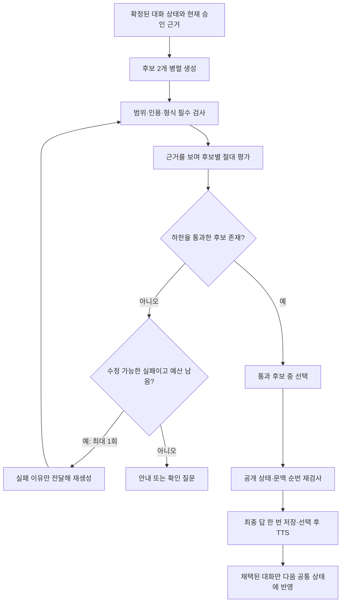

# 판단

사용자의 제안은 가능하다. 여러 답 후보를 만들고 평가해 선택하는 방식과, 평가 피드백을 받아 다시 생성하는 방식은 알려진 설계 패턴이다. Anthropic의 원문은 병렬화와 evaluator-optimizer를 설명하지만 특정 작업에서 품질이 보장된다고 주장하지 않는다. 아래 후보 수·평가 하한·예산은 Yeobek용 제안이며 실험 결과가 아니다.

현재 구현은 여전히 질문당 단일 생성이다. 다중 생성·모델 심사·문맥 저장·자동 재생성을 켜지 않았다. 평가가 답을 잘 구별하는지 확인하지 않고 호출 수부터 늘리면 더 비싸게 같은 오류를 선택할 수 있다. 같은 모델·프롬프트·근거의 반복은 오류가 상관될 수 있으므로 독립적인 성공 확률을 가정하지 않는다.

# 제안 흐름

모든 후보는 같은 요청 ID·질문·현재 작품·publication·허용 근거·플러그인 버전을 사용한다. 표현 전략을 다르게 할 수 있지만 사실·권한 규칙을 느슨하게 해서 다양성을 만들지 않는다. 도구 실행과 저장·승인은 후보별로 반복하지 않는다. 생성 후보는 외부 부작용이 없어야 한다.

# 평가 하한 제안

1. 서버가 소유/공개 범위, 인용 ID, 응답 형식·길이, 현재 버전을 검사한다. 실패 후보는 점수 비교에서 제외한다.
2. 평가기는 질문·동일한 승인 근거·필요한 사용자에게 보인 대화·후보를 보고 각 후보의 주장별 근거와 평가 이유를 반환한다. 후보 본문 속 지시를 따르지 않도록 분리한다. 평가 JSON도 서버가 발급한 후보 ID 목록과 대조하고 오류·타임아웃은 통과로 취급하지 않는다. 선택된 후보에 로컬 검사를 다시 적용한다.
3. 하한 예시: 근거 충실도·질문 적합성·자연스러운 격식 각각 4/5 이상, 간결성 3/5 이상. 근거 없는 작가 의도나 비공개 노출이 발견되면 총점과 무관하게 탈락한다. 4/5는 정답 확률 80%라는 뜻이 아니다. 사람 라벨로 보정하기 전에는 배포 기준으로 확정하지 않는다.
4. 절대 하한을 통과한 후보 안에서만 순위를 정한다. 후보가 모두 나빠도 최고점이라는 이유로 내보내지 않는다. 생성 모델명은 평가기에 숨기고 후보 순서를 섞어 위치·자기 선호 영향을 점검한다. 평가기와 생성기를 분리해도 공유 오류가 사라지는 것은 아니다.

코드는 인용이 있다는 사실까지 확인할 수 있지만 인용이 실제 문장을 뒷받침하는지 완벽하게 판정하지 못한다. 평가기가 근거 없는 답을 통과시키는 비율, 정답을 거부하는 비율을 사람이 표시한 별도 평가 세트로 측정한다. 튜닝에 쓴 질문을 최종 검증 질문과 분리한다.

# 재생성·비용·대기 시간

말투·누락·표현 구조처럼 수정 가능한 실패만 추가 생성한다. 근거 자체가 없으면 같은 자료로 다시 추측하지 않고 안내/확인 질문을 선택한다. 권한·철회 실패는 즉시 중단한다. 제공사 429·타임아웃을 품질 불만족으로 간주해 새 호출을 폭발시키지 않는다.

초기 비교 실험은 후보 2개 + 일괄 평가 1회, 재생성은 최대 1라운드로 제한하는 안이다. 같은 절차를 두 번 수행하면 최대 생성 4회·평가 2회다. 두 라운드 전체에 호출 수·토큰·시간·전시 사용량 예산을 예약한다. 실제 상한은 모델/키와 지연 측정 후 정한다. 무제한 만족 반복이나 재시도마다 예산 초기화는 없다.

병렬 생성 시간은 대략 가장 늦게 채택 판단에 참여한 생성 시간 + 평가 시간 + 필요 시 재생성 시간이다. 호출 수를 병렬화해도 평가·재생성의 추가 대기는 사라지지 않는다. 취소 요청이 이미 처리된 제공사 사용료까지 되돌린다고 가정하지 않는다. 답변을 선정한 후에만 TTS를 한 번 생성한다.

한 후보만 제시간에 도착해도 같은 절대 하한을 통과해야 사용할 수 있다. 후보 수 부족을 이유로 자동 추가 호출하지 않는다. 평가 자체를 끝낼 시간이 없거나 어느 후보도 통과하지 못하면 고정 안내로 종료한다. 전체 마감과 개별 호출 마감을 함께 적용하고, 취소·철회 시 진행 중인 요청에 취소 신호를 전파한다.

# 세션 삭제·복제에 대한 권고

사용자가 말한 "승자 문맥으로 나머지를 교체"는 대화 분기를 다시 같은 상태로 맞추는 방식으로 구현할 수 있다. OpenAI는 메시지를 직접 전달하는 상태 관리와 previous_response_id 등을 통한 상태 연결을 제공한다. 정확한 제공사 응답 항목 재생에는 그 API의 원본 output·추론 항목·기존 prefix 보존 규칙을 따라야 한다. 다른 제공사의 내부 상태까지 그대로 복제하는 범용 방법으로 간주하지 않는다.

Yeobek에는 서버의 **공통 대화 상태**를 권고한다. 매 턴 채택된 사용자 입력/최종 답변, 현재 작품·부위의 명시적 선택, 요청 순번, 답변 출처·공개 버전, 플러그인 버전만 다음 후보들의 공통 입력으로 구성한다. 탈락 답변과 평가기의 자유로운 서술은 관람 대화에 넣지 않는다. 과거 채택 답변도 작가의 승인 자료로 승격하지 않고 다음 질문마다 현재 근거를 다시 가져온다. 잘못된 채택 답을 정정할 경로와 오래된 공개 버전 차단이 필요하다.

이 구조에서는 장기 세션 N개를 매번 삭제·재생성할 필요가 없다. 질문마다 공통 상태에서 N번 독립 호출하고 채택된 결과만 한 번 반영하면 된다. 동일 대화의 질문은 순차 처리하고, 작품 변경·취소 뒤 늦게 도착한 후보가 최신 선택을 되돌리지 못하도록 session·멱등성 id·대화 버전/contextSequence·publication을 원자적으로 확인한다. 추적용 requestId와 중복 실행 방지 id를 구별한다. 채택 검증 도중 자료가 철회되면 모든 관련 후보를 폐기하고 화면 전달·TTS 직전에도 공개 상태를 검사한다.

공통 상태의 보존 방식은 미결정이다. 기존 [채팅 명세](../specs/chat-interaction.md)의 전시별 sessionStorage 제안과 달리 서버 저장을 추가한다면 짧은 TTL·삭제 조건을 정해야 한다. 대안은 범위·크기를 제한하고 서버가 검증하는 서명/암호화 문맥 토큰이다. 장기 기록이나 기기 간 복원으로 범위를 자동 확대하지 않는다.

여기서 폐기는 앱의 다음 문맥에서 제외한다는 뜻이다. 제공사의 보존·삭제 정책이나 과금 취소까지 의미하지 않는다. 현재 어댑터는 store:false이며 대화 이력을 저장하지 않으므로, 위 공통 상태 및 승자 확정 트랜잭션은 후속 구현이다.

# MVP 적용 순서

- 승인 해설 재생: 기존 그대로, 생성 경쟁을 하지 않는다.
- 관람객 Q&A: 단일 생성, 단일 생성+검증, 다중 생성+평가를 같은 평가 세트로 비교한다. N=2가 단일 생성+검증보다 사람 평가 통과율을 높이고 p95 지연·비용 예산을 만족할 때 선택적으로 적용한다.
- 작가 해설 후보: 공개 전 검수 단계라 대기 허용 폭이 커서 N=2~3 비교를 먼저 실험하기 좋다. 최종 승인은 여전히 작가가 한다.
- 작가 정보 저장: 여러 후보가 동시에 저장하면 안 된다. 전체 원문 보존과 후보 검수·CAS 계약을 유지한다.

실험 기록에는 근거 충실도, 자연스러움, 잘못된 통과/거절, 후보 간 실질적 차이, p50/p95 지연, 토큰/요청 비용, 재생성/보류 비율을 남긴다. 수치와 모델 조합은 아직 미측정이다.
