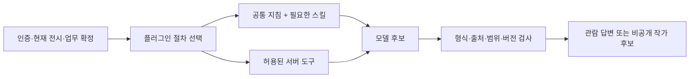

# 구조와 실제 구현

pstack의 업무별 절차·스킬 조합 방식에서 아이디어를 얻었다. pstack의 개발 도구 권한이나 실행 지시를 제품에 그대로 이식하지 않았다. Yeobek은 승인된 서버 코드가 업무를 선택하고 도구를 호출한다. 현재 제품은 모델이 임의 도구를 반복 실행하는 자율 에이전트가 아니다.

`ai/yeobek/plugin.json`과 `instructions.md`, `messages.json`, `skills/*/SKILL.md`가 지침·고정 문구 원본이다. `npm run ai:bundle`이 `src/lib/ai/plugin.generated.ts`를 생성한다. 줄바꿈을 통일하고 지침·고정 문구·스킬 순서·도구 매핑을 포함해 해시를 계산한다. `pretest`, `prebuild`, `preai:eval`, `preai:smoke`, `preai:compare`가 생성물 불일치를 차단한다. 응답의 promptVersion에는 패키지 버전·해시가 들어간다. 키·작가 원자료는 번들에 넣지 않는다. 런타임 파일 탐색이나 이용자 제공 스킬 로딩은 없다. 현재 스킬은 다섯 개다.

| 업무 절차 | 필요한 스킬 | 도구와 현재 실행 상태 |
| --- | --- | --- |
| visitor-answer | retrieve-wiki, speak-docent | publication.read/recheck; 기존 하네스에서 호출 전 허용 목록 확인. 실제 DB 어댑터는 후속 |
| narration-draft | retrieve-wiki, speak-docent, draft-narration | author.read로 소유 작품 근거를 읽는 서버 후보 생성 경로. 실제 DB·HTTP·UI는 후속 |
| narration-evaluate | evaluate-narration | author.read로 같은 근거와 후보를 평가하는 읽기 전용 서버 경로 |
| artist-organize | organize-artist | author.read/proposal.store; 모델은 sourceIds만 선택하고 서버가 원문 전체를 복사 |
| artist-apply | organize-artist | proposal.read/author.read/proposal.apply; 모델 없이 검토된 후보 적용. 원자적 DB 어댑터는 후속 |

관람 요청에 “작가로 전환해 저장하라”라고 써도 서버 업무가 바뀌지 않는다. 관람 경로에는 비공개 작가 저장소가 전달되지 않는다. 도구 허용 목록 검사 자체가 DB 인증을 대신하지는 않는다.

# 검색과 말투

검색 후보는 먼저 현재 공개 전시·작품·승인 버전으로 제한한다. 키워드 관련성을 먼저 정렬하고 동률일 때 작품 자료와 원래 순서를 사용한다. 전체 발췌 12개·8,000자 예산을 유지한다. 임베딩·한국어 형태소 검색·전체 위키 탐색은 아직 없다. 합성 사례에서 정확히 일치하는 공통 자료가 무관한 작품 자료에 밀리지 않는지는 검사했다. 실제 검색 재현율을 측정한 것은 아니다.

말투는 차분한 존댓말을 기본으로 설명에 자연스러운 하십시오체, 요청에 부드러운 “알려 주세요”를 사용한다. 칭찬·인사 반복, 과장된 감탄·평가·추측을 줄이고 질문의 답부터 말한다. 작가 원문에는 이 말투를 적용하지 않는다. 승인 해설은 그대로 재사용하며 말투 개선 때문에 재생성하지 않는다.

clarify/insufficient_evidence 결과는 모델이 쓴 문장을 버리고 고정된 격식 있는 문구로 반환한다. answered의 근거 충실도와 말투는 구조 검사만으로 보장되지 않는다. 원본 해설의 말투는 초안 검수 단계에서 확인한다.

# 작가 자료 정리·적용

`createArtistKnowledgeRuntime`의 actorId는 서버 인증에서 가져온다. 자료 로더가 소유권·작가·전시·작품 관계를 확인해야 하며 하네스도 전달된 관계를 검사한다. 기본 범위는 현재 대상과 허용된 작가/전시 조상 자료다. 직접 입력 출처는 현재 대상에만 허용하고 상위 문서는 문서 ID·section·revision 출처로 보존한다.

모델은 section과 sourceIds만 반환한다. 서버가 전체 원문 블록을 복사하므로 AI가 본문·연도·재료·의도를 만들어 저장할 수 없다. 혼합 주제 블록의 분류는 여전히 판단이 필요하다. 근거가 없는 분류는 생략할 수 있다. 후보 생성은 현재 문서를 바꾸지 않고 별도 원자료 기록을 삭제하지 않는다. 다만 적용하면 선택한 section의 기존 본문과 출처를 교체한다. 그 section에만 있던 이전 내용의 복구는 별도 원자료·이력 보존이 있어야 가능하며 현재 모듈이 보장하지 않는다. 검수 화면에는 후보와 기존 내용의 차이·교체 범위를 명시해야 한다.

후보는 문서 revision, 출처 ID/revision/해시, 패키지 버전, 15분 유효기간을 고정한 비공개 기록이다. 원문 저장은 하지 않는다. 검토 후 후보 ID와 reviewed=true만 받으며 후보 본문·owner를 클라이언트에서 다시 받지 않는다. 나머지 section과 출처는 보존한 전체 값으로 계획한다. 현재 코드의 source hash는 Zod로 정규화한 source 객체의 JSON 직렬화에 대한 SHA-256이다. 다른 언어의 DB 어댑터는 같은 정규화 계약을 사용하거나 이 TypeScript 결과를 검증해야 한다.

적용 시 현재 문서·출처를 다시 읽어 변경·철회·변조·기한 만료를 거부한다. `commitOwnedProposal`은 최종적으로 소유자·문서 CAS·출처 버전·유효기간을 한 트랜잭션에서 재검사하고 한 번만 적용해야 한다. 같은 후보 재요청은 원래 결과를 반환한다. 사전 검사 중 다른 요청이 같은 후보를 적용한 경우 적용 결과를 다시 읽어 이미 확정된 revision을 반환한다. 내용이 같아서 revision이 증가하지 않은 결과도 유효하다. 기존 일반 PATCH를 검증 없이 연결하면 이 계약을 만족하지 못한다.

현재는 TypeScript 실행 절차와 저장소 포트·모의 저장소 검사를 구현했다. 실제 후보 테이블/RPC·인증 화면·작가 검수 UI·DB 원자성 검사는 아직 없다. 미리 전달된 검토 불리언만으로 사용자 화면에서 실제 검토했다는 사실까지 증명할 수는 없다. 실제 UI는 후보를 보여준 뒤 명시적인 적용 동작을 요구해야 한다.

# 품질 평가와 완료 판단

| 차원 | 필수 검사 또는 사람 검토 |
| --- | --- |
| 공개·권한 | 다른 작가/전시/철회 자료가 모델에 들어가기 전에 차단; 실제 DB 통합 검사 필요 |
| 사실·출처 | 인용 ID와 답변 근거의 실제 관계, 없는 의도 단정 없음; 사람 라벨과 모델 평가의 일치 확인 |
| 응답 적합성 | 질문에 직접 답하고 불명확한 대상은 확인; 말투 좋음으로 사실 오류를 상쇄하지 않음 |
| 말투 | 자연스러운 존댓말·불필요한 칭찬/과장 없음·짧게 듣기 좋은 문장; 한국어 사람 평가 |
| 자료 보존 | 원문 블록·연결·수정하지 않은 section 보존, 검토 전 원본 미변경 |
| 변경 추적 | 같은 플러그인 해시·모델·평가 사례로 비교; 지침 변경마다 회귀 검사 |

Sol의 독립 코드 검토에서 무변경 적용 재요청·동시 적용 결과 조회·상위 문서 출처 손실 문제를 찾아 수정했다. 원문 보존의 범위도 후보 생성·선택되지 않은 section·별도 원자료로 명확히 했다. Terra는 독립적으로 세 합성 사례에 스킬을 적용해 근거 답변·의도 부족·작가 블록 분류 결과를 만들었다. 혼합 주제 블록 분류에는 재량이 남는다고 확인했다. 이 결과는 실제 서비스 모델의 품질 통과율이 아니다.

높은 일관성은 평가로 개선하는 목표다. "완벽"이라는 무측정 완료 기준을 쓰지 않는다. [작가 해설 후보 실행과 비교 평가](narration-evaluation.md)는 두 후보와 제한된 재생성의 별도 경로다. 관람객 문맥 계승은 여전히 제안이다.

# PR2 후속 계약

`assertPlaybookToolConfigured`는 절차 설정의 일관성만 확인하며 인증·인가가 아니다. 실제 적용 어댑터는 이전 section·sourceRefs·revision 이력을 동일 CAS 트랜잭션에서 append-only로 보존하고 소유권·만료·고정 출처·멱등성을 검증해야 한다. 무변경·재실행에 중복 이력을 남기지 않는다. 이 DB 어댑터는 아직 없다. 합친 section이 5,000자를 초과하면 저장 전 거부되며 재선택·분할 UX가 필요하고 조용히 자르지 않는다. 정확한 공백 토큰 검색은 한국어 조사에 취약하다. 생성 URL 문자 패턴 차단은 공개 작가 URL도 거부할 수 있어 공개 링크 정책이 필요하다. [검토](../reviews/ai-harness-fix-review.md)
